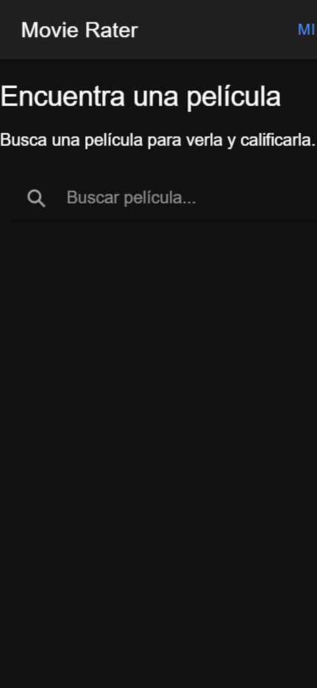
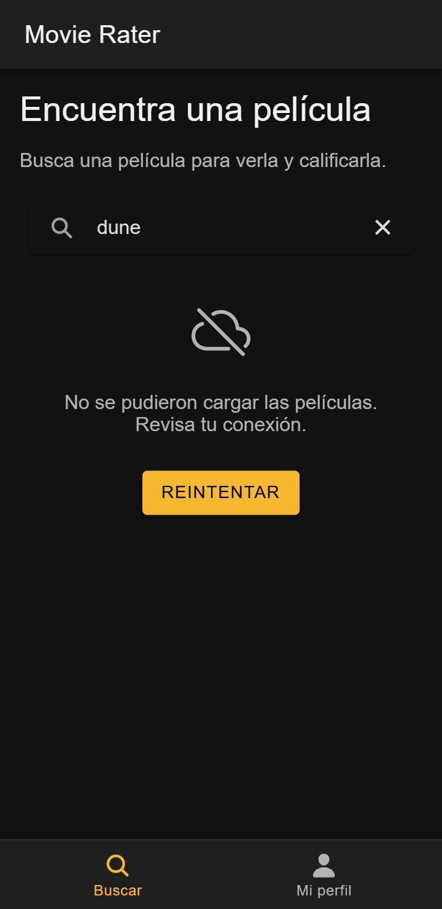
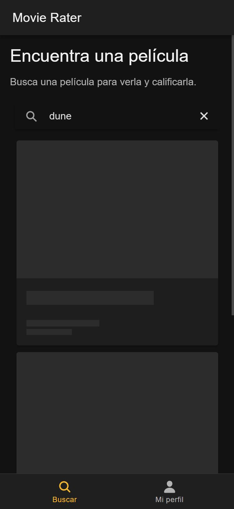
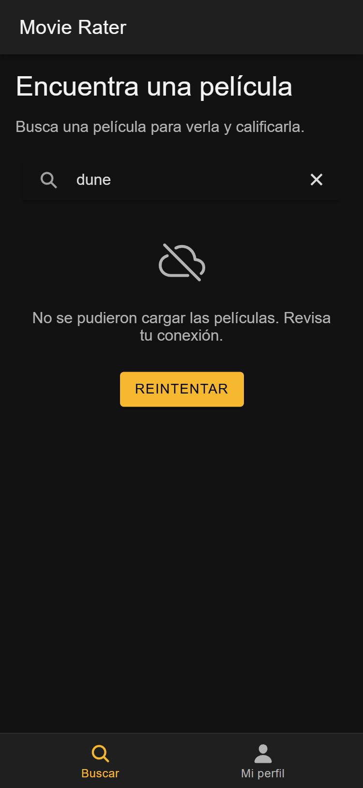
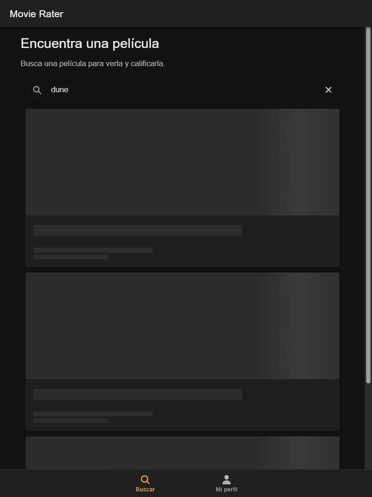

# Rediseño UX de una pantalla · Movie Rater (Semana 11)

Actividad opcional de refuerzo · Programación Móvil · 2026-B
**Autor:** William Erney Collo Narvaez (`11William11`)

Pantalla rediseñada: **Home** (`/tabs/buscar`) de Movie Rater, la app de mi equipo (Ionic React +
TypeScript): busca películas en TMDB y las muestra como tarjetas. El rediseño lo hice en el
[taller W11](../workshop/) y la app ya rediseñada está copiada en
[`movie-rater-app/`](movie-rater-app/).

## Cómo ejecutar

```bash
cd movie-rater-app
npm install
npm run dev        # http://localhost:5173
npm test           # 2 pruebas (Vitest), una cubre el estado de error y "Reintentar"
```

La búsqueda usa TMDB: hay que crear `movie-rater-app/.env` con `VITE_TMDB_API_KEY=<clave>` (está en
`.gitignore`).

## Antes y después

| Antes (375 px) | Después (360 px) |
|---|---|
|  |  |

| Antes | Después |
|---|---|
| El botón «Mi perfil» del encabezado se cortaba a 375 px (solo se leía «MI») | Pestañas abajo con «Buscar» y «Mi perfil», siempre visibles |
| Título y texto pegados al borde (`Home.css` vacío) | Márgenes y tamaños con tokens de diseño (`theme/variables.css`) |
| Mientras buscaba: solo un spinner | Tarjetas *skeleton* con la forma de la tarjeta de película |
| Si TMDB fallaba: un texto rojo, sin forma de reintentar | Estado de error con botón **Reintentar** |
| Búsqueda sin resultados: pantalla en blanco | Estado vacío con botón **Limpiar búsqueda** |
| Zoom con los dedos bloqueado (`user-scalable=no`) | Zoom permitido |

## 1. Jerarquía y navegación (40)

**Acción principal:** buscar una película. El buscador está arriba, solo, y debajo van los
resultados; la pantalla no tiene más botones que compitan con él.

**Patrón de navegación: pestañas + pila.**

- Pestañas abajo (`IonTabs`) para las dos secciones principales, **Buscar** y **Mi perfil**: siempre
  a la vista y al alcance del pulgar.
- Pila para el detalle: `/movie/:id` se abre encima, con flecha de regreso, porque es un paso dentro
  de «Buscar» y no una sección nueva.

| Ruta | Pantalla | Cómo se llega |
|---|---|---|
| `/tabs/buscar` | Home | Pestaña «Buscar», o al iniciar sesión |
| `/tabs/perfil` | Mi perfil | Pestaña «Mi perfil» |
| `/movie/:id` | Detalle | Tocar una tarjeta; la flecha vuelve a `/tabs/buscar` |

Archivos: [`src/pages/Tabs.tsx`](movie-rater-app/src/pages/Tabs.tsx) y
[`src/App.tsx`](movie-rater-app/src/App.tsx). Los tokens de color, letra y espacio están en
[`src/theme/variables.css`](movie-rater-app/src/theme/variables.css). El detalle del patrón está en
[`02-design-tokens.md`](../workshop/docs/02-design-tokens.md) del taller.

## 2. Estados de carga, datos y error (40)

| Cargando | Error |
|---|---|
|  |  |

| Estado | Qué ve el usuario | Cómo se fuerza para probarlo |
|---|---|---|
| Cargando | Tres tarjetas skeleton (`IonSkeletonText`) con póster, título y fecha | `/tabs/buscar?retraso=3000` y escribir en el buscador |
| Con datos | Tarjetas con póster, título, fecha y calificación; al tocar una se abre el detalle | Buscar un título real, por ejemplo `dune` |
| Error | «No se pudieron cargar las películas. Revisa tu conexión.» y botón **Reintentar** | `/tabs/buscar?falla=1` y escribir en el buscador, o sin red |
| Vacío | «No encontramos películas para «…»» y botón **Limpiar búsqueda** | Buscar un texto que no existe, por ejemplo `zzqqxx` |

Código: [`src/pages/Home.tsx`](movie-rater-app/src/pages/Home.tsx) y
[`src/components/MovieListSkeleton.tsx`](movie-rater-app/src/components/MovieListSkeleton.tsx).
La prueba [`Home.test.tsx`](movie-rater-app/src/pages/Home.test.tsx) simula que TMDB falla,
comprueba el mensaje de error, pulsa **Reintentar** y verifica que se repite la búsqueda.

## 3. Accesibilidad (20)

**Contraste.** Todos los pares de texto y fondo superan 4.5:1 (WCAG 2.1 AA). Algunos ejemplos:

| Texto | Fondo | Contraste |
|---|---|---|
| Texto principal `#f2f2f2` | Fondo `#121212` | 16.73:1 |
| Texto secundario `#b3b3b3` | Tarjeta `#1e1e1e` | 7.95:1 |
| Pestaña activa `#f5b82e` | Barra de pestañas `#1f1f1f` | 9.24:1 |
| Texto de botón `#000000` | Primario `#f5b82e` | 11.78:1 |
| Error `#ff6b6b` | Fondo `#121212` | 6.75:1 |

La tabla completa (13 pares) está en [`02-design-tokens.md`](../workshop/docs/02-design-tokens.md).

**Tamaño táctil.** Los botones de calificación pasaron de 36 px de alto a un mínimo de **48 × 48 px**
(el mínimo recomendado es 44 px); las pestañas de Ionic ya miden más de 48 px de alto.

**Otros arreglos:** se volvió a permitir el zoom; la calificación se lee «Calificación TMDB: 7.8 de
10» en vez de solo una estrella; los botones «1 a 5 estrellas» usan `aria-pressed` para no depender
solo del color; los tamaños de letra están en `rem`; desde 768 px las tarjetas pasan a rejilla.

Lighthouse (Accesibilidad, modo móvil): Home **94 → 100**.

| 360 px | 768 px |
|---|---|
|  |  |
