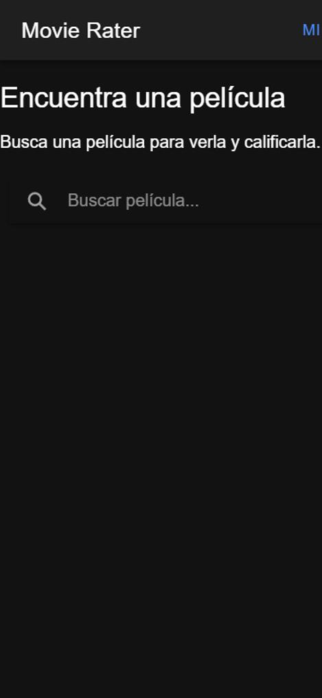
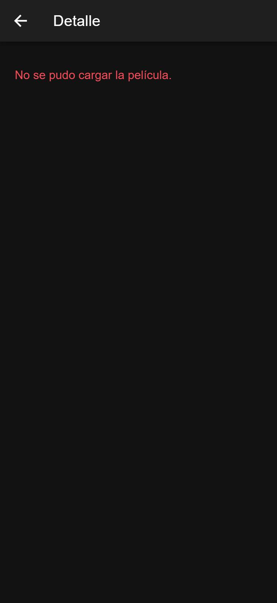
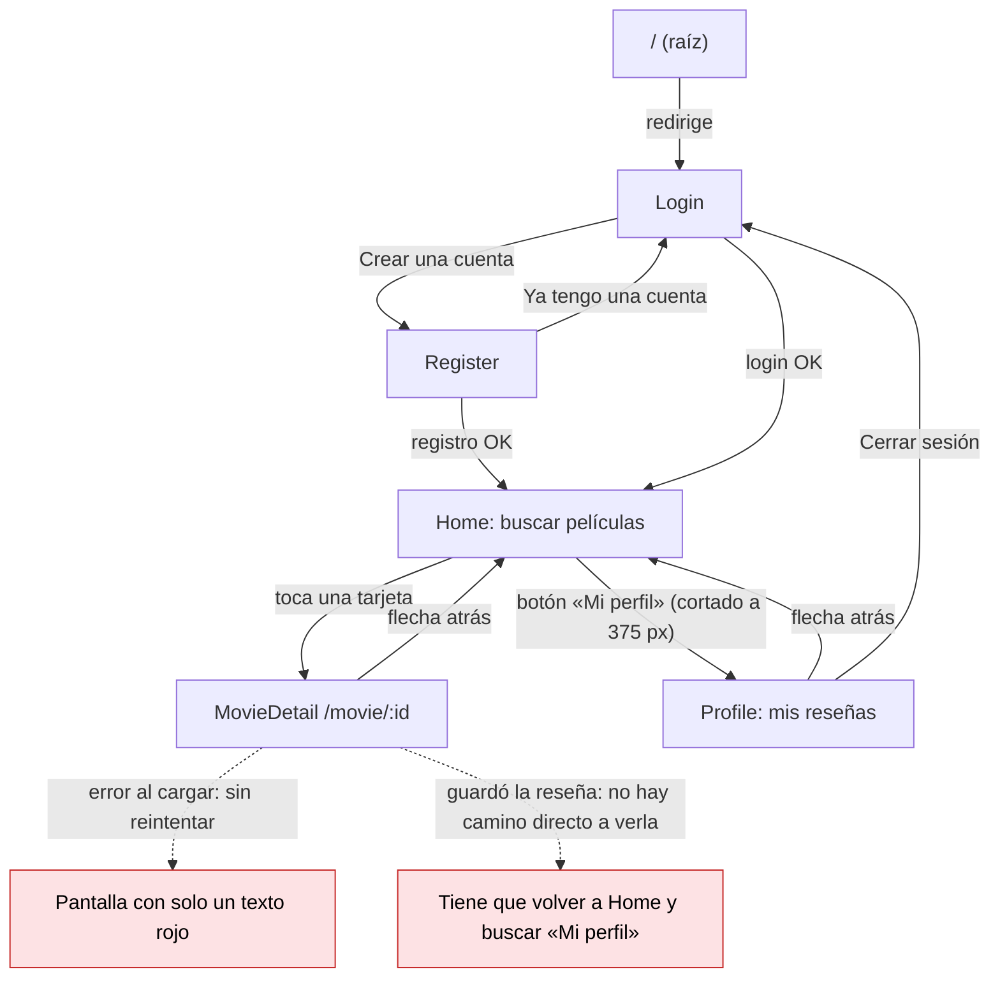

# CP1 · Auditoría UX de mis pantallas

Pantallas auditadas: **Home** (búsqueda y lista de películas de TMDB, `/home`) y **MovieDetail** (detalle y reseña, `/movie/:id`). Capturas tomadas a 375 px de ancho, tal como está la app en la línea base:

| Home | MovieDetail |
|---|---|
|  |  |

## Hallazgos

| Pantalla | Problema | Principio | Severidad | Arreglo propuesto |
|---|---|---|---|---|
| Home | El botón «Mi perfil» del encabezado se corta a 375 px (solo se lee «MI») | Comportamiento en pantalla pequeña | Alta | Sacar el perfil del encabezado y llevarlo a una pestaña |
| Home | Solo se llega al perfil por un botón de texto; no hay secciones principales visibles | Patrón de navegación | Alta | `IonTabs` con «Buscar» y «Mi perfil» |
| Home | El título y el texto quedan pegados al borde izquierdo (`Home.css` está vacío) | Jerarquía visual | Media | Margen interno con tokens de espacio |
| Home | Mientras busca solo hay un spinner y «Buscando películas...», sin la forma de las tarjetas | Estados de la interfaz (cargando) | Media | Skeleton con la forma de la tarjeta de película (póster, título, fecha) |
| Home | Si TMDB falla solo aparece un texto rojo, sin forma de reintentar | Estados de la interfaz (error) | Alta | Estado de error con botón «Reintentar» |
| Home | Una búsqueda sin resultados deja la pantalla en blanco | Estados de la interfaz (vacío) | Alta | Mensaje «No encontramos películas para …» y acción para limpiar la búsqueda |
| Home | Cada letra que se escribe dispara una petición a `/search/movie`; los resultados pueden llegar en desorden | Retroalimentación | Media | Esperar a que el usuario deje de escribir antes de buscar |
| Home | La calificación se muestra como «⭐ 7.8»: el lector de pantalla no dice qué es ese número | Textos y etiquetas | Baja | «Calificación TMDB: 7.8» |
| MovieDetail | Si la película no carga solo queda «No se pudo cargar la película.» sin botón de reintentar | Estados de la interfaz (error) | Alta | Estado de error con «Reintentar» y «Volver a buscar» |
| MovieDetail | Un id que no existe (`/movie/abc`) muestra el mismo error genérico | Estados de la interfaz | Media | Estado «Película no encontrada» |
| MovieDetail | Al guardar la reseña el mensaje sale como texto plano, igual para éxito y error, y el botón se puede pulsar dos veces | Retroalimentación | Alta | Deshabilitar el botón mientras guarda, `IonToast` de éxito y mensaje de error |
| MovieDetail | Los botones «1 ⭐» a «5 ⭐» indican la selección solo con el relleno del botón | Color como única forma de dar información | Media | `aria-pressed` y texto «Tu calificación: 4 de 5» |
| MovieDetail | El título usa `font-size: 28px` fijo: no crece si el usuario agranda la letra | Accesibilidad (texto escalable) | Baja | Tamaños en `rem` desde los tokens |

## Mapa de navegación actual

Los nodos en rojo son donde el usuario se pierde.

