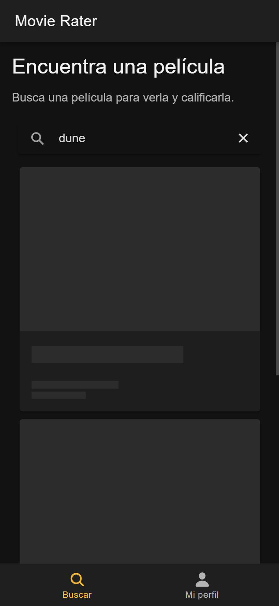
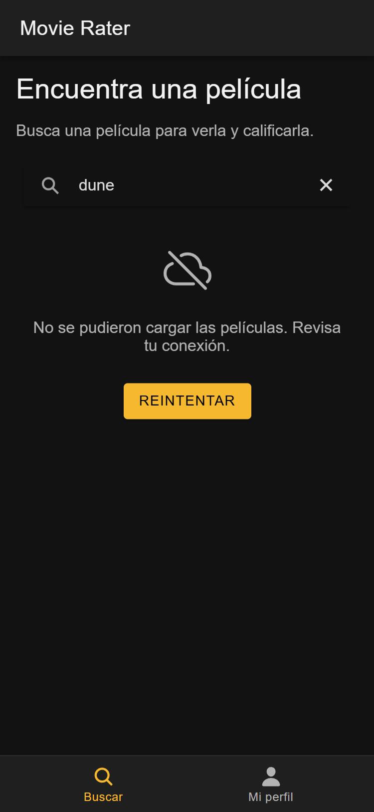

# CP3 · La pantalla de lista con sus tres estados

Pantalla: **Home** (`/tabs/buscar`), lista de películas que devuelve TMDB (`GET /search/movie`) para el texto buscado.

| Cargando | Error |
|---|---|
|  |  |

## Estados

| Estado | Qué ve el usuario | Cómo se fuerza |
|---|---|---|
| Cargando | Tres tarjetas skeleton (`IonSkeletonText`) con la forma de la tarjeta de película: póster, título, fecha y calificación | Abrir `/tabs/buscar?retraso=3000` y escribir en el buscador: la respuesta tarda 3 s |
| Error | Ícono de sin conexión, «No se pudieron cargar las películas. Revisa tu conexión.» y botón **Reintentar**, que repite la misma búsqueda | Abrir `/tabs/buscar?falla=1` y escribir en el buscador. También pasa si TMDB rechaza la petición o no hay red |
| Vacío | Ícono de película, «No encontramos películas para «…»» y botón **Limpiar búsqueda** | Buscar un texto que no existe, por ejemplo `zzqqxx`, con una clave de TMDB válida |
| Con datos | Tarjetas con póster, título, fecha y calificación; al tocar una se abre `/movie/:id` | Buscar un título real, por ejemplo `dune`, con una clave de TMDB válida |

Los parámetros `retraso` y `falla` los lee `simulateNetwork()` en `app/src/services/tmdb.ts` antes de llamar a TMDB.

Además, deslizar hacia abajo (`IonRefresher`) repite la búsqueda actual.

**Pendiente:** las capturas de «Vacío» y «Con datos» necesitan una clave de TMDB en `app/.env` (`VITE_TMDB_API_KEY`). Esta copia de la app no la tiene, así que esos dos estados no se pudieron capturar todavía.

## Prueba automatizada

`app/src/pages/Home.test.tsx` (Vitest + Testing Library) simula que TMDB falla, comprueba que aparece el mensaje de error, pulsa **Reintentar** y verifica que se vuelve a pedir `dune` y que aparece el estado vacío.

```bash
cd 11-week/workshop/app
npm test
```

Resultado: 2 pruebas pasan (la de la línea base y la nueva).
