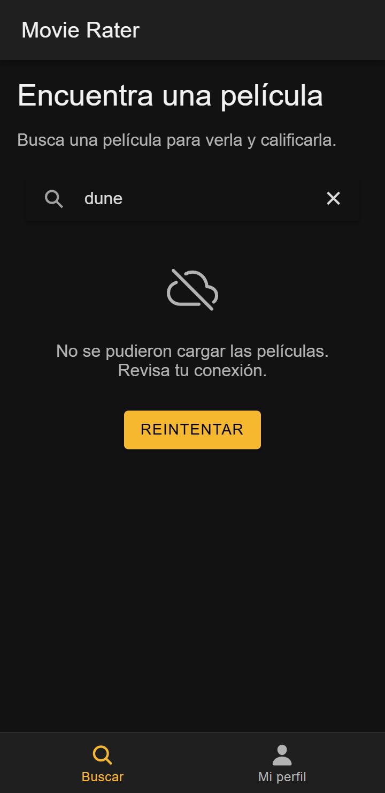
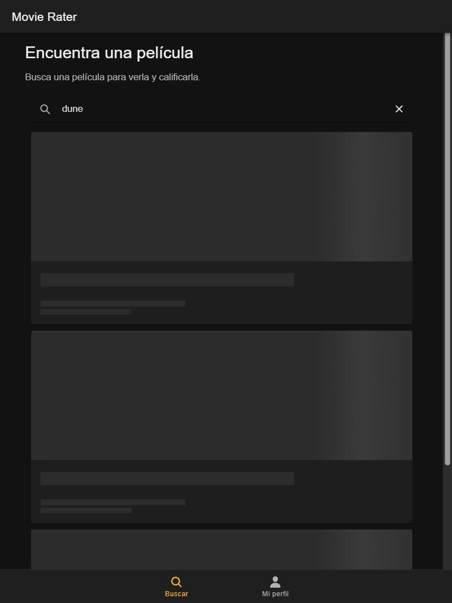

# CP4 · Accesibilidad y diseño responsivo

Pantallas: **Home** (`/tabs/buscar`) y **MovieDetail** (`/movie/:id`).

## Lo corregido

| Problema | Dónde | Corrección |
|---|---|---|
| La app bloqueaba el zoom con los dedos (`maximum-scale=1.0, user-scalable=no`): una persona con baja visión no podía ampliar | `app/index.html` | Se quitaron esas dos opciones del `meta viewport` |
| Los botones «1 ⭐» a «5 ⭐» indicaban la selección solo con el relleno del botón (color como única forma de dar información) | MovieDetail | `aria-pressed` en cada botón, grupo con `aria-label="Tu calificación"` y texto visible «Seleccionaste 4 de 5 estrellas.» |
| El lector de pantalla leía «estrella» sin decir qué significaba | Home y MovieDetail | La estrella va con `aria-hidden` y el texto dice «Calificación TMDB: 7.8 de 10»; cada botón de calificación tiene `aria-label="N de 5 estrellas"` |
| Botones de calificación de 36 px de alto, menos de los 44 px mínimos para el dedo | MovieDetail | `min-height` y `min-width` de 48 px |
| Título del detalle con `font-size: 28px` fijo que no crecía con la letra del sistema | MovieDetail | `var(--mr-font-size-xl)` en `rem` (CP2) |
| En tableta cada póster ocupaba todo el ancho y había que hacer mucho scroll | Home | A partir de 768 px las tarjetas se acomodan en una rejilla (`grid` con columnas de 200 px como mínimo) |

## Lighthouse (categoría Accesibilidad, modo móvil)

| Pantalla | Antes | Después |
|---|---|---|
| Home `/tabs/buscar` | 94 | 100 |
| MovieDetail `/movie/603` | 93 | 100 |

Antes, la única auditoría que fallaba en las dos pantallas era `meta-viewport` (zoom bloqueado).

Medido con Lighthouse 12.6.1 (el mismo motor de la pestaña Lighthouse de Chrome) en modo móvil. MovieDetail se midió en su estado de error, porque esta copia de la app no tiene clave de TMDB.

## Pantalla pequeña y tableta

| 360 px | 768 px |
|---|---|
|  |  |

A 360 px no hay desplazamiento horizontal (`scrollWidth` = 360) y las pestañas caben completas. A 768 px el contenido se centra con un ancho máximo de 700 px.
