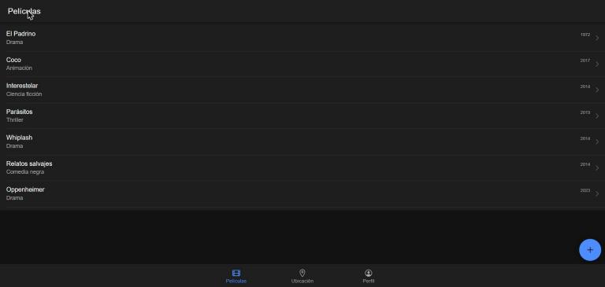
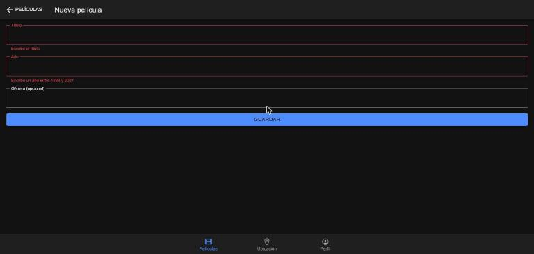
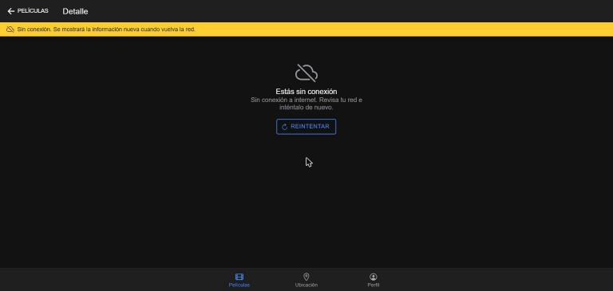

# Movie Rater — App con hardware y conectividad (c3-activity)

Actividad calificable c3 (Corte 3) · Programación Móvil · 2026-B
**Autor:** William Erney Collo Narvaez (`11William11`)

App Ionic React + Capacitor que integra lo del corte 3: el **GPS** con manejo de permisos, el
**login por token** contra mi API con manejo del **401** y de la **falta de red**, y una UX con
pestañas y los tres estados (**carga / datos / error**) en cada pantalla. Parte de las opcionales de
la [semana 12](../../12-week/03-optional-activity/) (GPS) y la
[semana 13](../../13-week/03-optional-activity/) (token).

| Carpeta | Contenido |
|---|---|
| [`movie-rater-api/`](movie-rater-api/) | API Express: `POST /auth/login` (JWT) y las rutas de `/peliculas` protegidas |
| [`movie-rater-app/`](movie-rater-app/) | App Ionic React con pestañas Películas / Ubicación / Perfil |
| [`img/`](img/) | Capturas de la verificación en el navegador |

## Cómo ejecutarlo

Requisitos: Node.js 20 o superior. Se necesitan dos terminales.

```bash
# Terminal 1: API en http://localhost:3000
cd movie-rater-api
npm install
npm start
npm test        # 11 pruebas de la API

# Terminal 2: app en http://localhost:8100
cd movie-rater-app
npm install
npm run dev
npm test        # 10 pruebas unitarias de la app (Vitest)
```

Usuario de prueba: **`admin` / `movie123`** (se cambia con las variables `AUTH_USUARIO` y
`AUTH_CONTRASENA` de la API).

Si el puerto 3000 está ocupado, la API arranca en otro con `PORT` y la app se apunta a ella con
`VITE_API_URL` (así se hizo la verificación de abajo):

```bash
PORT=3100 npm start                                          # en movie-rater-api
VITE_API_URL=http://localhost:3100 npx vite --port 8200      # en movie-rater-app
```

## Qué pide la rúbrica y dónde está

| Criterio | Qué hace la app | Dónde |
|---|---|---|
| **Plugin (GPS) + permisos** · 1.5 | `@capacitor/geolocation`. La pantalla muestra el estado del permiso sin pedirlo (chip *concedido / negado / aún no se ha pedido*) y solo lo pide al tocar **Obtener mi ubicación**. Si el usuario lo niega, explica cómo activarlo | [`ubicacion.ts`](movie-rater-app/src/services/ubicacion.ts), [`MiUbicacion.tsx`](movie-rater-app/src/pages/MiUbicacion.tsx) |
| **Token + 401 + sin red** · 1.5 | Login que guarda el JWT con `@capacitor/preferences` y lo envía en `Authorization: Bearer`. Con 401 borra el token y vuelve al login con «Tu sesión expiró». Sin red (`@capacitor/network`) no intenta la petición, muestra una franja de aviso y recarga sola al volver la red | [`peliculasApi.ts`](movie-rater-app/src/services/peliculasApi.ts), [`sesion.ts`](movie-rater-app/src/services/sesion.ts), [`token.ts`](movie-rater-app/src/services/token.ts), [`conexion.ts`](movie-rater-app/src/services/conexion.ts), [`useIrAlLogin.ts`](movie-rater-app/src/hooks/useIrAlLogin.ts) |
| **UX (estados) + 1 prueba** · 1.5 | Pestañas, y detalle y formulario con botón atrás; skeleton mientras carga, datos, lista vacía y error con **Reintentar** en lista, detalle y ubicación; deslizar para actualizar; validación del formulario. **10 pruebas unitarias** | [`useRecurso.ts`](movie-rater-app/src/hooks/useRecurso.ts), [`Tabs.tsx`](movie-rater-app/src/pages/Tabs.tsx), [`components/`](movie-rater-app/src/components/), archivos `*.test.ts(x)` |
| **«Quality & connectivity» (EN)** · 0.5 | Sección en inglés al final de este README | [Quality & connectivity](#quality--connectivity) |

## Navegación

```
/login ──(login correcto)──▶ /tabs
                              ├── Películas ──▶ Detalle   (/tabs/peliculas/:id)
                              │             └─▶ Nueva     (/tabs/peliculas/nueva, botón +)
                              ├── Ubicación  (GPS)
                              └── Perfil     (usuario, vencimiento de la sesión, red, cerrar sesión)

sin token · token vencido · respuesta 401 ──────────▶ /login  («Tu sesión expiró…»)
```

**Nueva** y **Detalle** se abren encima de la lista dentro de la pestaña Películas: la barra de
pestañas sigue visible y el botón atrás («‹ Películas») vuelve a la lista.

## Los tres estados de cada pantalla

El hook [`useRecurso`](movie-rater-app/src/hooks/useRecurso.ts) carga los datos y devuelve uno de
tres estados; las pantallas solo dibujan el que toca.

| Pantalla | Cargando | Datos | Error |
|---|---|---|---|
| Películas | Filas *skeleton* | Lista (o «Aún no hay películas» con botón para agregar) | Icono, mensaje y **Reintentar**. Si ya había datos, se quedan y el error sale en un *toast* |
| Detalle | Tarjeta *skeleton* | Tarjeta con título, género y año | Icono, mensaje y **Reintentar** |
| Nueva | Spinner en **Guardar** | Vuelve a la lista, que se recarga | Errores bajo cada campo (sin gastar petición) o el mensaje de la API |
| Ubicación | Spinner en el botón | Latitud, longitud y precisión | «Permiso de ubicación denegado» o «No se pudo obtener la ubicación…» |

## Manejo de errores (todo en `peliculasApi.ts`)

| Situación | Qué hace el servicio | Qué ve el usuario |
|---|---|---|
| No hay token guardado | `SesionRequeridaError`, sin llamar a la API | Pantalla de login |
| El token ya pasó su `exp` | Lo borra y lanza `SesionRequeridaError(vencida)`, sin llamar a la API | Login con «Tu sesión expiró. Inicia sesión de nuevo.» |
| La API responde **401** | Borra el token y lanza `SesionRequeridaError(vencida)` | Lo mismo |
| `@capacitor/network` dice que no hay red | `SinConexionError`, sin llamar a la API | Franja amarilla y «Estás sin conexión» con **Reintentar** |
| La API no responde (apagada) | `Error` | «No se pudo conectar con el servidor. Inténtalo más tarde.» |
| La API tarda más de 10 s | Cancela con `AbortController` | «El servidor tardó demasiado en responder…» |
| 400 / 404 / 500 | `Error` con el mensaje de la API | Ese mensaje (p. ej. «No existe la película 99») |

El 401 se maneja en un solo lugar: [`useIrAlLogin`](movie-rater-app/src/hooks/useIrAlLogin.ts)
recibe el error y, si es de sesión, navega al login. Ninguna pantalla revisa códigos HTTP.

## Pruebas

**App** (`npm test` en `movie-rater-app`): **10 pruebas, 0 fallos** (Vitest + Testing Library).

| Archivo | Prueba |
|---|---|
| [`token.test.ts`](movie-rater-app/src/services/token.test.ts) | Lee el usuario y la hora de vencimiento del JWT |
| | `tokenVencido` es falso antes del `exp` y verdadero desde el `exp` o con un token mal formado |
| [`peliculasApi.test.ts`](movie-rater-app/src/services/peliculasApi.test.ts) | Envía el token en la cabecera `Authorization` |
| | Con 401 borra el token y lanza `SesionRequeridaError` |
| | Sin conexión no llama a la API y lanza `SinConexionError` |
| | Con el token vencido no llama a la API y lo borra |
| | Si `fetch` falla con red, avisa que el servidor no responde |
| [`useRecurso.test.tsx`](movie-rater-app/src/hooks/useRecurso.test.tsx) | Pasa de cargando a error y, al reintentar, a datos |
| | Con la sesión vencida navega a `/login?motivo=expirada` |
| | Si una recarga falla con datos en pantalla, conserva los datos y deja el error en el aviso |

Para comprobar que las pruebas detectan fallos, quité el borrado del token en el 401: la prueba
correspondiente falló, y volvió a pasar al restaurar el código.

**API** (`npm test` en `movie-rater-api`): **11 pruebas, 0 fallos** (login correcto e incorrecto, sin
token, token vencido, token firmado con otra clave y los endpoints de películas).

`npm run build` (TypeScript + Vite) compila sin errores.

## Verificación en el navegador

2026-11-07, en Chrome, con la API en `:3100` y la app en `:8200`. Las peticiones se revisaron en el
registro de red del navegador.

| Paso | Resultado |
|---|---|
| Abrir la app sin sesión | Va directo a `/login` |
| Login con contraseña incorrecta | `POST /auth/login → 401` y «Usuario o contraseña incorrectos» |
| Login con `admin` / `movie123` | `POST /auth/login → 200`, un solo `GET /peliculas → 200` y la lista con 6 películas y las pestañas |
| Abrir **Coco** y volver | `GET /peliculas/2 → 200`; al volver, la lista se refresca sin borrar lo que se ve |
| **Guardar** con el formulario vacío | Título y año en rojo con su mensaje; no se envía ninguna petición |
| Crear *Oppenheimer* (2023, Drama) | `POST /peliculas → 201`, vuelve a la lista y aparece la película nueva |
| Pestaña **Perfil** | Usuario `admin`, la sesión vence 1 hora después del login, «Red: En línea» |
| Sin red (simulada: `navigator.onLine = false` y evento `offline`) | Franja «Sin conexión…» en las pantallas que usan la API y «Red: Sin conexión» en el perfil |
| Abrir **Whiplash** sin red | «Estás sin conexión» con **Reintentar**; no sale ninguna petición |
| Vuelve la red (evento `online`) | La franja desaparece, la lista se recarga sola (`GET /peliculas → 200`) y **Reintentar** carga el detalle |
| API apagada | La lista conserva sus datos y muestra el aviso «No se pudo conectar con el servidor…»; el detalle de **Parásitos** muestra el estado de error |
| API encendida con otra `JWT_SECRETO` y **Reintentar** | `GET /peliculas/4 → 401`, el token se borra y aparece el login con «Tu sesión expiró. Inicia sesión de nuevo.» |
| Pestaña **Ubicación** | El chip lee el permiso real de Chrome: «aún no se ha pedido» |
| GPS con permiso negado (respuesta simulada) | Chip «negado» y «Permiso de ubicación denegado» con cómo activarlo |
| GPS con permiso concedido (posición simulada) | Spinner con el botón deshabilitado y luego latitud, longitud y precisión; chip «concedido» |
| Recargar la página | La sesión sigue: el token quedó en Preferences |

| Lista | Validación del formulario | Detalle sin conexión |
|---|---|---|
|  |  |  |

**Límites de esta verificación:**

- El diálogo de permiso de Chrome no se puede pulsar desde la automatización, por eso las respuestas
  del GPS (negado y concedido) se simularon en el navegador. El manejo del permiso en el celular es el
  mismo código de la [semana 12](../../12-week/03-optional-activity/).
- No se generó un APK. Para hacerlo hace falta Android Studio: `npm run build`, `npx cap add android`,
  `npx cap sync android` y agregar `ACCESS_COARSE_LOCATION` y `ACCESS_FINE_LOCATION` al
  `AndroidManifest.xml`.
- En modo desarrollo, el `StrictMode` de React ejecuta dos veces los efectos al montar, así que el
  detalle hace dos `GET`. En el build de producción hace uno.
- El token en Preferences queda en el almacenamiento privado de la app, pero no cifrado. Para datos
  más sensibles habría que usar el Keystore de Android o el Keychain de iOS.

## Quality & connectivity

The app asks for the location permission only when the user taps "Get my location"; before that it
only reads the current state with `checkPermissions()` and shows it in a chip, so the user always
knows whether the permission is granted, denied or not requested yet.
On Android and iOS the location service calls `requestPermissions()` when the state is "prompt", and
if the user denies it, the service throws a `PermisoDenegadoError` that the screen turns into a clear
message explaining how to enable the permission in the settings, instead of failing silently.
After a successful login, the JWT returned by `POST /auth/login` is stored with
`@capacitor/preferences`, which keeps it in the app's private storage (SharedPreferences on Android,
UserDefaults on iOS), and it is sent in the `Authorization: Bearer` header of every protected request.
Before each request the app reads the token's `exp` claim: if the token has already expired, the app
deletes it and opens the login screen without calling the API.
If the API still answers 401, for example because the server key changed, the service deletes the
token too, and the login screen tells the user that the session expired.
All HTTP calls go through one service, `peliculasApi.ts`, which turns every failure into a typed
error: `SesionRequeridaError` for a missing or rejected token, `SinConexionError` when
`@capacitor/network` reports that the device is offline, a timeout error after 10 seconds, and the
API message for 400 and 404 responses.
A single hook, `useRecurso`, maps those errors to the three screen states (loading skeleton, data, or
error with a Retry button), and when a refresh fails while data is already on screen, it keeps the
data and shows a toast instead of a blank error page.
When the network comes back, the offline banner disappears and the movie list reloads by itself.
Ten Vitest unit tests cover the token parsing, the Authorization header, the 401 and offline paths of
the service and the state changes of the hook, and the API keeps its eleven `node:test` tests for the
login and the protected routes.
